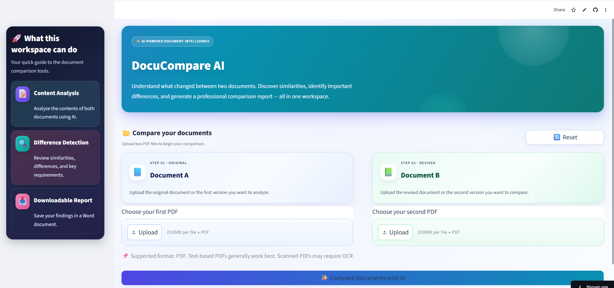
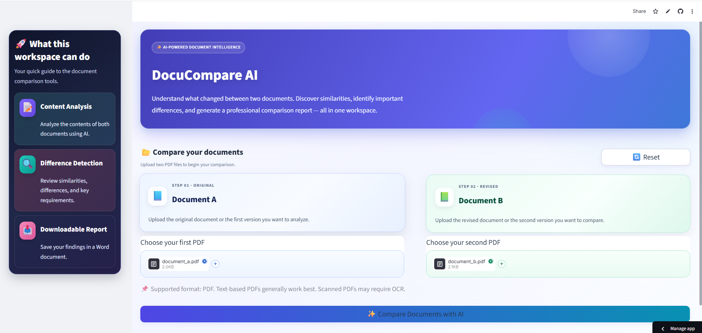
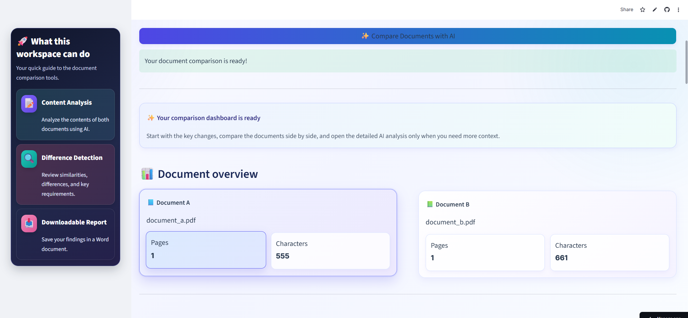
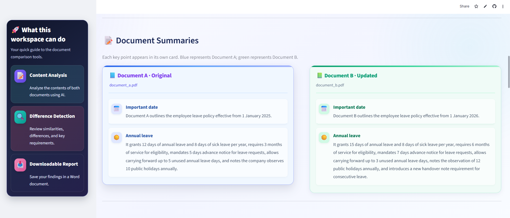
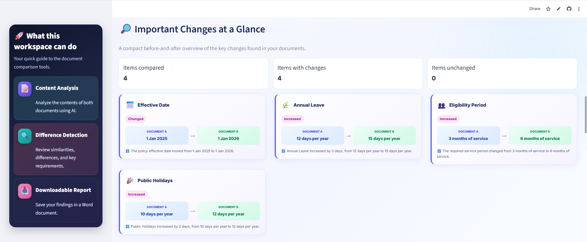
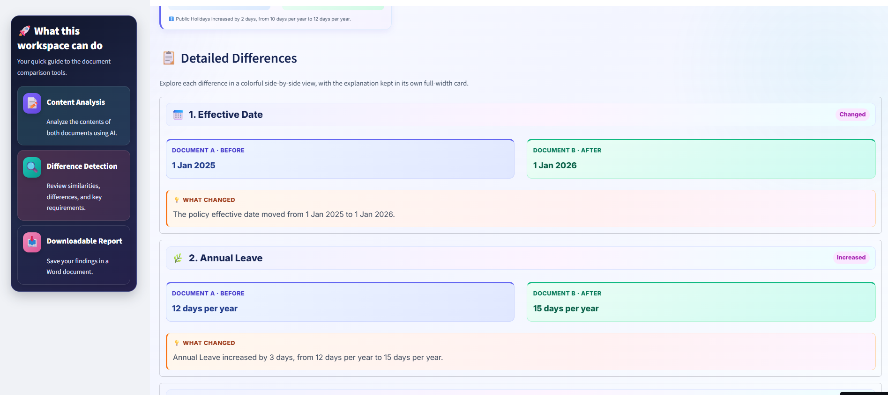
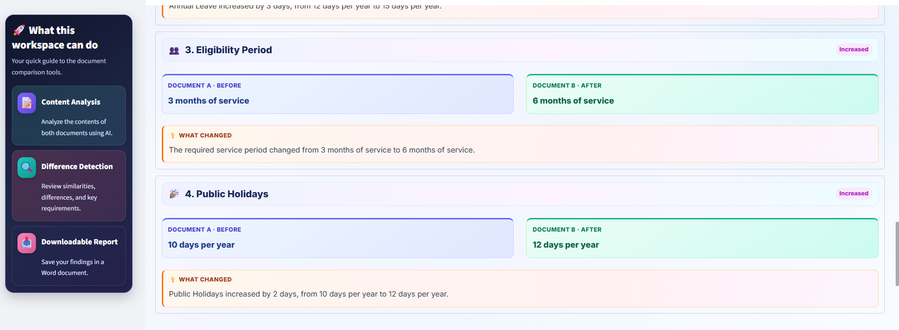
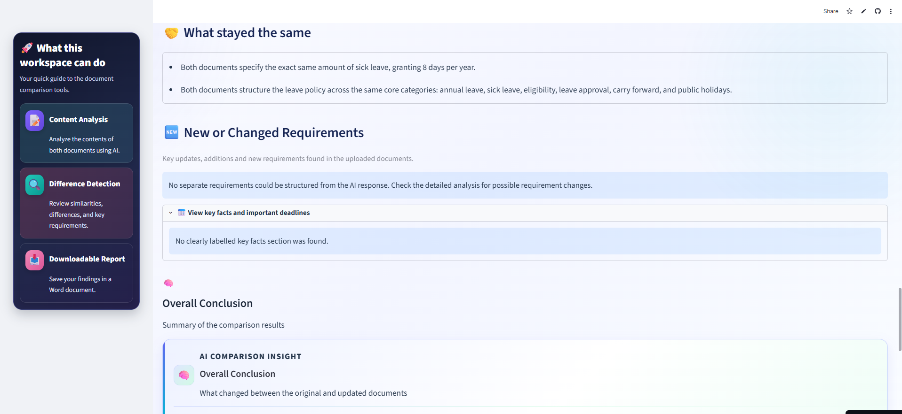
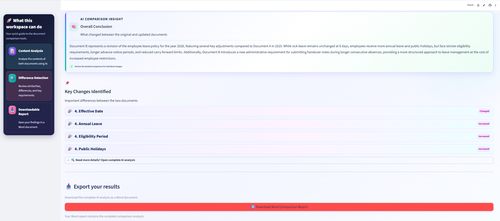

# 🤖 DocuCompare AI — AI Document Comparison Assistant

An AI-powered web application that compares two PDF documents, summarizes their contents, identifies similarities and differences, extracts important facts, dates, and requirements, and generates a downloadable Word comparison report.

Built with Python, Streamlit, and Google's Gemini API, DocuCompare AI helps users understand document changes through an organized, interactive interface.

## 🚀 Live Demo

- **Live Application:** [Try DocuCompare AI](https://ai-document-comparison-assistant-ddrd7wfomkkjdwb47ulvfm.streamlit.app/)
- **GitHub Repository:** [View Source Code](https://github.com/chethansree77/ai-document-comparison-assistant)

## ✨ Key Features

- 📄 **PDF Upload:** Upload two PDF documents for comparison.
- 📝 **Text Extraction:** Extract readable text from PDFs using PyPDF.
- 🧠 **AI Summarization:** Generate AI-powered summaries for both documents.
- 🔍 **Similarity Detection:** Identify common information and overlapping content.
- ⚖️ **Difference Analysis:** Highlight important changes between documents.
- 📌 **Key Information Extraction:** Identify significant facts, dates, requirements, and details.
- 📊 **Interactive Results:** Display document summaries and comparison findings in an organized interface.
- 📥 **Word Report Generation:** Generate and download a formatted comparison report.
- 🔄 **Reset Functionality:** Clear the current comparison and upload new documents.
- ⚠️ **Input Validation:** Handle missing uploads and PDFs without readable text.
- 🎨 **Custom UI:** Gradient styling, visual cards, hover effects, and an interactive layout.

## 🛠️ Technologies Used

| Technology | Purpose |
|---|---|
| Python | Core application logic and document processing |
| Streamlit | Interactive web interface |
| Google Gemini API | AI-powered summarization and comparison |
| Google Gen AI SDK (`google-genai`) | Integration with Google's generative AI models |
| PyPDF (`pypdf`) | Extracting text from PDF documents |
| `python-docx` | Creating downloadable Word reports |
| `python-dotenv` | Loading environment variables and API configuration |
| ReportLab | PDF generation capabilities, where used by the application |

**Core concepts demonstrated:** Generative AI, prompt-based document analysis, PDF processing, report generation, API integration, and interactive Python application development.

## ⚙️ How It Works

The application follows a multi-step document-processing workflow:

1. **Upload:** The user uploads Document A and Document B.
2. **Validate:** The application checks the uploaded files and their readability.
3. **Extract:** Text is extracted from both PDF documents.
4. **Analyze:** The application uses the Gemini API to generate summaries and analyze the documents.
5. **Compare:** Similarities, differences, important dates, and requirements are identified.
6. **Present:** The results are organized into sections in the Streamlit interface.
7. **Generate:** A formatted Word comparison report is prepared for download.

This workflow combines document processing, AI analysis, and report generation rather than relying on a single chatbot prompt.

## 🖥️ Application Screenshots

### 1. Homepage and Hero Banner



### 2. PDF Upload Section



### 3. Document Overview



### 4. Comparison Results



### 5. AI Summaries and Key Findings



### 6. Document Summaries



### 7. Key Changes and Findings



### 8. Comparison Report



### 9. Report Download Section



## 📁 Project Structure

```text
ai-document-comparison-assistant/
│
├── app.py
├── comparison.py
├── document_reader.py
├── report_generator.py
├── requirements.txt
├── .env.example
├── .gitignore
├── README.md
│
├── sample_documents/
│   ├── document_a.pdf
│   └── document_b.pdf
│
├── screenshots/
│   ├── homepage_and_hero_banner.png
│   ├── pdf_upload_section.png
│   ├── document_overview.png
│   ├── comparison_results.png
│   ├── ai_summaries_and_key_findings.png
│   ├── document_summaries.png
│   ├── key_changes_and_findings.png
│   ├── comparison_report.png
│   └── report_download_section.png
│
└── tests/
```

### Main Files

- **`app.py`** — Streamlit interface and application workflow.
- **`document_reader.py`** — PDF text extraction and document reading.
- **`comparison.py`** — AI-powered document comparison logic.
- **`report_generator.py`** — Comparison report generation.
- **`requirements.txt`** — Python dependency list.
- **`.env.example`** — Example environment configuration without a real API key.
- **`tests/`** — Project tests and validation checks.
- **`screenshots/`** — Images documenting the application interface.

## 💻 Installation and Setup

### Prerequisites

- Python installed on your computer
- Git
- A Google Gemini API key
- Visual Studio Code or another code editor

### Step 1: Clone the repository

```bash
git clone https://github.com/chethansree77/ai-document-comparison-assistant.git
```

### Step 2: Open the project directory

```bash
cd ai-document-comparison-assistant
```

### Step 3: Create a virtual environment

```bash
python -m venv venv
```

### Step 4: Activate the virtual environment

**Windows PowerShell:**

```powershell
.\venv\Scripts\Activate.ps1
```

If PowerShell blocks activation, follow the Python environment instructions appropriate for your system.

### Step 5: Install dependencies

```bash
python -m pip install -r requirements.txt
```

### Step 6: Configure the Gemini API key

Create a `.env` file in the project root directory and add:

```text
GEMINI_API_KEY=your_actual_api_key
```

Replace the placeholder with your own Gemini API key.

**Security note:** Never commit your real `.env` file or expose your API key publicly. The `.gitignore` file should exclude `.env`.

For Streamlit Community Cloud, configure the required API key in the application's **Secrets** settings instead of uploading a local `.env` file.

### Step 7: Run the application

```bash
python -m streamlit run app.py
```

Open the local URL displayed in your terminal, usually:

`http://localhost:8501`

## 📖 How to Use

1. Open the application.
2. Upload the first PDF as **Document A**.
3. Upload the second PDF as **Document B**.
4. Click **Compare Documents**.
5. Review the summary of each document.
6. Explore the similarities and differences.
7. Review important dates, requirements, and key findings.
8. Download the generated Word comparison report.
9. Use the reset functionality to compare another pair of documents.

## 🧪 Testing and Validation

The application has been tested for important document-processing and reporting workflows, including:

- PDF text extraction from sample documents.
- Document comparison and report generation.
- Word report structure and table formatting.
- Streamlit interface operation.
- Input validation and reset functionality.

To run the project's automated tests, activate the virtual environment and execute:

```bash
python -m pytest
```

If pytest is not installed, install it with:

```bash
python -m pip install pytest
```

The tests available in the repository determine which checks actually run.

## 🔐 Security and Privacy

- Store API credentials in a local `.env` file.
- Keep `.env` excluded from version control.
- Never hardcode or publish real API keys.
- Use `.env.example` for placeholder configuration.
- Configure deployment secrets securely.
- Avoid uploading confidential documents unless you are authorized to do so.
- Review the privacy requirements of any external AI service before submitting sensitive document content.

## 🌐 Deployment

DocuCompare AI is deployed using **Streamlit Community Cloud**.

**Live application:** [Open DocuCompare AI](https://ai-document-comparison-assistant-ddrd7wfomkkjdwb47ulvfm.streamlit.app/)

The deployed application requires the Gemini API key to be configured correctly in Streamlit Community Cloud secrets. Availability may also depend on API quotas and service status.

## 🎯 Project Objectives and Learning Outcomes

This project demonstrates practical experience with:

- Python application development.
- Generative AI and LLM API integration.
- PDF text extraction and document processing.
- AI-powered summarization and comparison.
- Structured report generation.
- Streamlit web application development.
- Environment variable and API credential management.
- Application testing and deployment.

The goal is to make comparing two documents easier by presenting their key information and changes in a clear, organized format.

## 👩‍💻 Author

**Chintha Chethana Sai Sree**

Aspiring Python Developer | Generative AI Enthusiast

- **GitHub Profile:** [@chethansree77](https://github.com/chethansree77)
- **Project Repository:** [DocuCompare AI](https://github.com/chethansree77/ai-document-comparison-assistant)

---

*Built as a practical Generative AI application development project.*
